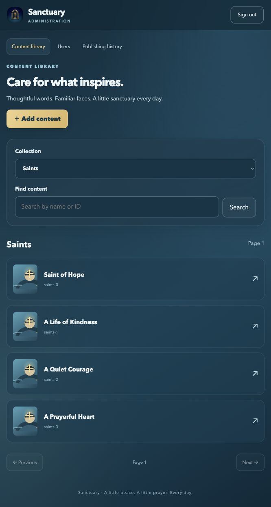

# Admin usability upgrade

Branch: `codex/admin-usability`, based on `main` at `859e507`. The existing admin implementation was already on main. This upgrade has not been merged or deployed; the owner handles the PR process.

## Approved scope checklist

- Live password requirement checklist and confirmation feedback; clear controls and password visibility toggles.
- Authenticator QR generated locally, with manual setup key fallback. No external QR service receives the key.
- Sanctuary navy, teal, and gold styling, branded authentication screen, compact content cards and thumbnails for prayers, saints, and novenas.
- Upload, preview, replace, and remove images. A replacement becomes attached when the content is published.
- Saints and novenas show their current intentions and patronages. Add opens a searchable, paginated picker; create and edit shared names in place. A new name is one database record available throughout the panel. Unlinking removes only the relationship. Editing the shared name changes it everywhere. Creating/renaming is saved immediately with an audit reason; linking waits for parent publication. Duplicate English names are rejected after whitespace/case normalization.
- Branded review/discard dialogs, keyboard focus management, and warnings only for actual unpublished edits. Reverted changes and language/picker navigation do not create false warnings. Browser tab closure still uses the browser's own unstyleable warning when there are real edits.
- One Users screen combines provider registrations and database profiles, registration and verification status, activity filters, saved content, novena progress, login counts and profile details. Accounts without app activity remain visible. Missing historical telemetry is not invented.
- Eight-hour idle and 24-hour maximum sessions, reload restoration, and secure HttpOnly session cookies. MFA and single-owner checks remain enforced.
- Web/API path isolation preserved; no native source or native workflow changes.

## Release details

Deploy API before web using the existing process. Flyway migration **V22** adds image storage, the cached registration directory, and novena patronage links. No AWS resource or IAM addition is needed beyond the existing directory-read permission. No live configuration or database was changed for this branch.

New web clients request `cookie-v2` MFA verification. The API sets an HttpOnly, Secure, SameSite=Strict cookie scoped to `/admin-api`; no admin token is stored in JavaScript storage. All admin calls still require the custom header and exact-origin CORS policy. Old already-loaded clients retain bearer response compatibility during rollout. Existing sessions keep their stored absolute expiry; newly issued sessions receive 24 hours. Browser heartbeats run only following trusted user interaction, so an unattended open tab does not indefinitely extend the idle window. Sign-out clears both server session and cookie, including late verification races.

JPEG and PNG uploads are limited to 5 MB. Browser preparation corrects orientation, resizes to at most 4096 × 4096 / 16 megapixels, and strips metadata. The server independently checks dimensions and decoded content and re-encodes it. SVG and other formats are rejected. Stored images use versioned public `/content/images/{uuid}` URLs with immutable cache headers. Replacing/removing a content image does not delete its previous stored bytes; older links remain valid. Unpublished uploads are retained; automated cleanup is outside this upgrade. Database backup size grows with uploads.

The unified directory refreshes from Cognito on access after five minutes, or using Refresh directory. It fetches all provider pages before publishing a snapshot; provider failures preserve the previous cache. Deleting an app profile clears its matching cached row; external provider deletions are reflected on the next successful refresh. Directory reads do not create profiles or activity. Active means a recorded authenticated request, not online presence. Historical login counts begin with activity instrumentation.

Angular framework packages were aligned to 21.2.26 and build tooling to 21.2.29 while adding the local QR dependency. Runtime dependency audit reports zero vulnerabilities. Development dependencies still have advisories; the runtime result is not a claim about the whole development tree.

## Validation

- API: 73 tests, zero failures/errors, one pre-existing skip; integration tests ran against disposable local PostgreSQL 15, including V22 migration, cookies/CSRF, MFA boundaries, shared terms, media and directory refresh failure rollback. CI uses PostgreSQL 17.
- Web: 26 tests passed across five files, including dirty-state, password controls, QR encoding, session restoration and late-response invalidation.
- Workflow isolation: six tests, 82 assertions passed.
- Complete production web build passed and generated 628 share-preview route objects. Warnings remain for the 573.77 kB initial bundle, 16.93 kB admin stylesheet, and the QR library's CommonJS packaging; all are below failure thresholds.
- Local browser checks used the synthetic loopback-only fixture in `apps/web/testing/admin-preview-server.py`. Verified unchanged-editor navigation, styled dirty warning, shared-term creation and application, browser image upload, unified Users, password checklist/matching, and local authenticator QR. No real user accounts or credentials were used.

For local UI review, run the fixture on loopback port 8080 and Angular on port 4300, then open `http://127.0.0.1:4300/admin?api=local`. The fixture is a testing helper only and is not included in the deployed application.
