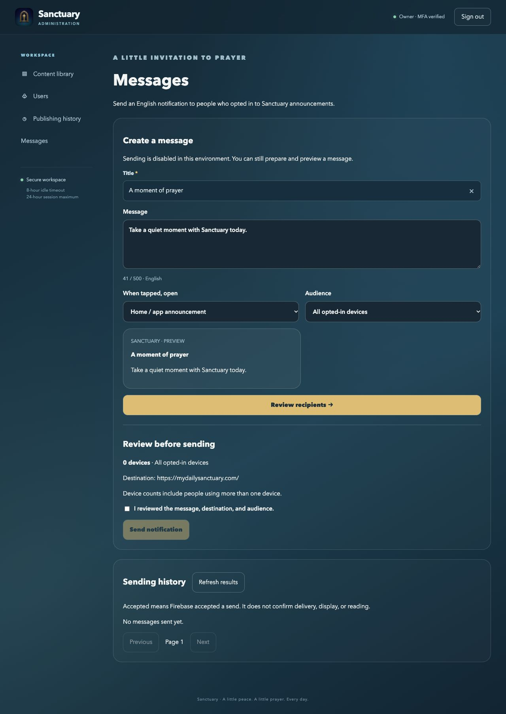
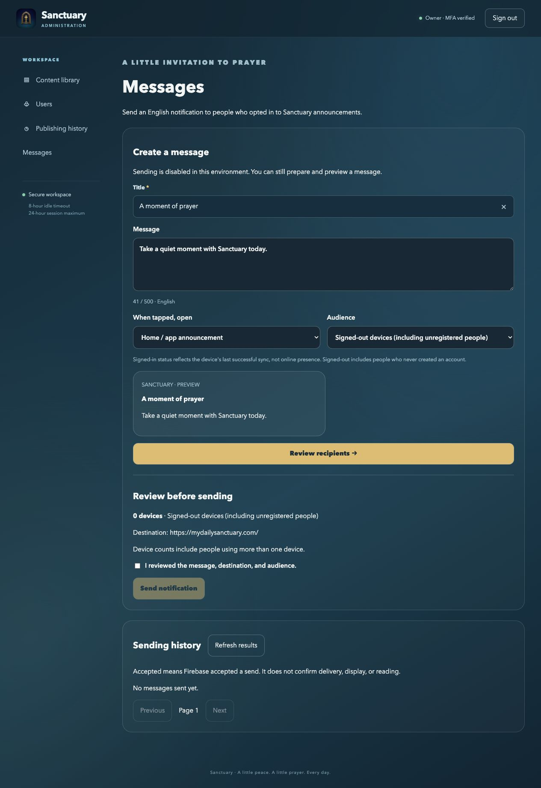

# Firebase messaging in Sanctuary

Current follow-up branch: `codex/anonymous-announcements`, based on merged DEV. iOS marketing version, Android versionName, and web package version are **1.0.17**. The original 1.0.16 implementation required sign-in; the follow-up adds anonymous opt-in. Existing CI computes mobile build numbers independently.

## Owner workflow

Open Admin → Messages. Write one English title and message. Choose Home for an app announcement, or select an existing prayer, saint/feast day, or novena invitation. Existing content is searched and paginated; destinations are constructed by the server from the database slug, never arbitrary external links.

The default audience is **Send test to my device**. A test device must belong to the verified owner in the current environment's public Cognito directory and have announcements enabled. Install 1.0.16, sign in, opt in under Me, and refresh Users (to sync the directory) and Messages. Other available audiences are all eligible devices, signed-in users, signed-out devices (including people who never registered), iOS, and Android. Sign-in status reflects the last successful device synchronization, not online presence. Counts are devices, not unique people.

Review the preview, destination and recipient count, then check the explicit confirmation before sending. Editing invalidates review. Unsent drafts trigger the existing discard prompt when leaving admin sections. Drafts are not persisted across reloads.

History records the owner subject, title, message, destination, audience, creation time, and per-message recipient totals: pending, accepted, failed, skipped, uncertain. Refresh results manually. Firebase acceptance does not prove delivery or display. Open/read tracking and campaign scheduling are not implemented.

## Delivery and consent

FCM uses project `sanctuary-7f082`. Existing DEV/UAT/production iOS/Android app registrations and Apple push configuration are reused. No Firebase Authentication, Firestore, or Analytics implementation is added; account authentication remains Cognito. Public mobile SDK configuration is in the app resources. Private service-account keys stay in AWS Secrets Manager, never Git or Angular.

Signed-in and anonymous installations can register. The Me screen exposes announcements before login, and no account is created for an anonymous registration. Announcement consent defaults off and is separate from local prayer reminders. The UI labels/privacy copy are translated, but message content is English. Device registration records an installation UUID, owner account, FCM token, platform, app version, consent, token validity and last synchronization. Registration updates after login, foregrounding, token changes and preference changes. Tokens are not returned in admin responses or send history.

Account deletion cascades device records. Logout detaches the account via anonymous registration while preserving the installation’s independent announcements preference. Login attaches the current account for the owner test/member audience; signed-out broadcasts include both former members and people who never registered. Network failures can delay synchronization; operating-system notification settings remain the immediate device-level control. Account deletion clears local announcements consent and invalidates the FCM token. Queued deliveries retain the original recipient account ID; transferring an installation cannot redirect an earlier queued notification to the new account.

Audience selection excludes invalid, opted-out or unsynchronized-for-60-days devices. The recipient snapshot is checked again when submitting, and consent/account ownership are checked again before dispatch. Each message has a client-generated idempotency UUID, retained on network retries. The database outbox claims deliveries once across API instances. Interrupted/ambiguous sends become uncertain after ten minutes and are not automatically replayed; no exactly-once delivery guarantee is claimed. FCM handles final transport. Notification expiry is one day. Sending is limited to twenty messages per hour per environment.

## Deployment and activation

1. Deploy API first; Flyway applies **V23__push_messaging.sql** and **V24__anonymous_push_installations.sql** as needed. This adds new tables and does not replace content or existing progress.
2. Deploy web and publish the new mobile builds through the normal DEV → production process. No native build is required for subsequent messages; this initial integration does require native releases.
3. Existing GitHub variables are reused: `API_DEV_FIREBASE_NOTIFICATIONS_ENABLED` / `API_PROD_FIREBASE_NOTIFICATIONS_ENABLED` and their `...FIREBASE_SERVICE_ACCOUNT_SECRET_ARN` values. Workflows inject `SANCTUARY_PUSH_ENABLED` and the private secret only when enabled. Default without configuration is false. The existing environment variables were already true during the audit; merging/deploying this branch therefore enables its sender in those environments.
4. ECS execution roles require read-only `secretsmanager:GetSecretValue` on their exact existing Firebase secret. `scripts/admin/firebase-secret-access.py dev` (or prod) prints the proposed policy; `--apply` attaches it and simulates permission. No secret values are read by that helper. **Approved and applied November 13, 2026:** the owner explicitly approved both exact-secret grants. The `SanctuaryFirebaseMessagingSecret` inline policy now allows each execution role to read only its own Firebase secret, and IAM simulation returned allowed for both. No service deployment or notification send accompanied this change.
5. Test with the owner's physical DEV phone first. Verify consent off → no eligible recipients, consent on → test device appears, foreground and background receipt, tapping each destination, logout, token refresh, and opt-out. Keep production broadcasts unused until this succeeds. This physical-device delivery test cannot be replaced by a simulator build or Google credential authentication.

The initial audit confirmed six app registrations, enabled FCM V1, and configured APNs development/production keys for all three Apple registrations. DEV and production Secrets Manager credentials match the existing active key and successfully authenticated against Google's OAuth token endpoint. This check did not send a message or test APNs delivery. Initial IAM simulation showed both API execution roles lacked secret-read permission; the owner subsequently approved the exact grants, which were applied and verified. No Firebase configuration was changed, no key was generated, and no broadcast was sent during implementation.

## Verification

The local PostgreSQL tests exercise opt-in filtering, stale audience rejection, idempotent submission, queue claims, opt-out before dispatch, uncertain-send handling, owner-only verified test targeting, and installation account transfer. Existing auth/cookie tests also guard a Firebase transitive-dependency regression: XML auto-negotiation is excluded so the API continues returning JSON.

Web tests cover preview invalidation and stable request IDs on retries. Full web production build, iOS simulator build and Android DEV/UAT/production compilation run locally. Real device delivery remains a release gate. Final local results: 31 web tests passed; 79 API tests ran with zero failures/errors and one pre-existing skip; 11 Android unit tests passed. iOS DEV simulator build passed, Android DEV/UAT/production variants compiled, and platform configuration verification passed. Seven workflow checks passed with 98 assertions. Existing warning-level bundle, stylesheet, CommonJS, Gradle and Swift concurrency warnings are separate from successful builds. Apple signing/provisioning profiles must include the Push Notifications capability; the unsigned simulator build does not validate distribution signing or APNs delivery.

This feature intentionally changes native source and triggers native validation/release workflows when their normal branch conditions apply. Later web/API-only edits remain isolated from native pipelines. Workflow tests also verify private credentials are injected only as secrets and only when enabled.

## DEV deployment corrections — November 13, 2026

The first merged DEV release passed PR validation but failed its deployment-job API tests because the job-level push-enabled setting leaked into Spring's test context without runtime credentials. API test steps now explicitly disable push, and the disabled-auth integration context also pins push off. Runtime credential validation remains fail-closed. All 79 API tests ran successfully (one existing skip), including a local run with the inherited push flag deliberately true.

The first iOS distribution archive also applied command-line provisioning/signing overrides to Firebase's Swift Package targets. DEV, UAT and production archive commands now use the existing app-target signing settings in the Xcode project, leaving package resources free of app provisioning profiles. A local Release-Dev device archive succeeded with signing disabled; signed TestFlight archive/upload must still pass in CI. Nine workflow regression checks passed with 115 assertions. No additional Firebase, IAM, or production changes were made for these corrections.

## Anonymous registration follow-up — 1.0.17

The only newly public operation is PUT `/push/installations`; account data and admin routes remain protected. Each installation supplies a private random credential kept in iOS Keychain or Android encrypted preferences. Only its SHA-256 hash is stored server-side. Updating a protected record requires this credential. A legacy registration can migrate using its actual FCM token (not a guessed installation ID), or authenticated ownership. A token already attached to a different protected installation cannot be claimed. The credential is never returned in admin lists/history. No Firebase/GCP/IAM permission changes are required.

V24 makes device account ownership nullable, adds the credential hash and monotonic registration version, expands audience values, and adds registration rate-limit buckets. Late/out-of-order registration requests cannot undo newer identity/consent state. Guest deliveries use a null-safe ownership check; queued owner tests cannot follow a device into a different account state.

Public registration is limited to 1,000 requests/hour per network peer and 10,000/hour globally, with at most 10,000 anonymous installations. Network peers may be shared behind a proxy. Anonymous rows not synchronized for 60 days are cleaned on new registration; opted-out rows remain ineligible. App Check/device attestation is not added in this version. Existing installation credentials and OS notification permission remain necessary for notifications; this does not push to arbitrary downloads or people who never opted in.

Settings now show a sync result and a refresh-registration control. Brand-new users who have never enabled announcements do not register with the Sanctuary API. Enabling announcements while signed out registers an anonymous device. Test targeting is intentionally still restricted to the verified, signed-in owner; use signed-out/all audiences for general invitations to guests.

Deploy API (V24) before web/mobile. Then install the **new 1.0.17 build**; **1.0.16 (189)** cannot register a guest. Test on a signed-out phone: enable announcements, confirm guest count increases without a Users entry, send an explicitly reviewed guest test message, opt out, sign in, sign out, and confirm audience changes after synchronization. Physical notification delivery must still be tested by the owner; no broadcast was sent during implementation.

Follow-up validation: 85 API tests ran with zero failures/errors and one existing skip; all 32 web tests and 11 Android unit tests passed. The iOS DEV simulator build, Android DEV/UAT/production compilation, and web production build passed. Existing web size/CommonJS warnings remain. Real signed-out push delivery still requires the new signed mobile build and owner testing.

## Recipient review and mobile reminder controls — 1.0.18

Message review now includes an expandable, searchable list of the exact eligible recipient devices from the reviewed audience. It shows platform, app version, account name/email when linked, signed-in/guest state, installation record ID, and last synchronization. It does not expose FCM tokens or installation credentials. Search only filters the displayed list; it does not change the broadcast audience. Physical phone model/name is not collected, so it is not invented. Deploy the API update before the web interface; no database migration or new IAM permissions are needed.

Me has one Notifications card for the existing global digest preferences and announcements, higher-contrast switches, a device-settings shortcut, and collapsed registration diagnostics. The global digest behavior remains unchanged. Individual reminder controls live on each prayer and novena detail page, not in Me. A chosen daily local-device reminder can be edited or removed there and includes the exact content link for notification taps. No account is needed for these local reminders. They recur until explicitly removed, including after a novena completes; they do not sync through the account or Firebase. Enabling a prayer reminder does not opt the device into announcements.

iOS uses repeating calendar notifications and leaves headroom under the platform pending-notification limit. Android persists per-item schedules, uses distinct intent URIs so reminders do not overwrite each other, restores schedules after reboot/app update/timezone changes, and uses battery-aware alarms (delivery may be delayed by Android). All app versions are 1.0.18. Signed builds and physical-device delivery/tap checks remain a release gate.

Validation: 86 API tests, zero failures/errors and one existing skip; 33 web tests; 14 Android unit tests including time rollover and daylight-saving cases; nine workflow checks with 115 assertions. Web production build, iOS DEV simulator build, and Android DEV/UAT/production compilation passed. On the iOS simulator, reminder creation, persistence after relaunch, removal, readable reminder-sheet styling, and the combined signed-out notification card were checked. No real broadcast was sent.

## Central reminder management — 1.0.19

Me now includes a Scheduled reminders card for all manually scheduled prayer/novena reminders on the current device, available signed in or signed out. It shows titles and daily times, removes individual schedules, and clears all item schedules after confirmation. Global digest preferences and announcement consent remain unchanged. The empty state points people back to prayer/novena detail pages to create reminders.

iOS Save is a full-width green action with a check icon; Delete is a separate red action with a trash icon. Android labels the time-picker confirmation Save reminder and distinguishes Change time from red Delete. The Android overview observes preference changes so deleting or creating schedules does not leave a stale list; iOS refreshes its OS notification list on appearance/foreground and reloads detail state when opening the reminder sheet.

Validation: iOS DEV simulator build, Android DEV/UAT/production compilation and all 14 Android unit tests passed. Simulator checks covered creation with the new Save button, the populated overview, clear-all confirmation, and the resulting empty state while announcement consent stayed unchanged. Local simulator screenshot: previews/reminder-management-ios.png. Physical Android UI testing remains a release check. Both mobile versions are 1.0.19; no API/database/Firebase/IAM changes are needed.

## Account-only reminders and environment links — 1.0.20

Reminder creation/editing requires sign-in and reuses the existing Save/Favorite account prompt on both mobile platforms. Scheduled reminder management appears only when authenticated. Android resumes the reminder action after sign-in without favoriting the content. Firebase announcements remain available to opted-in guests; existing local schedules are not silently deleted.

DEV notification destinations now use https://dev.mydailysanctuary.com through the DEV Spring profile. Production retains https://mydailysanctuary.com. DEV mobile handlers recognize DEV links; production handlers reject them. Install 1.0.20 before testing DEV tap navigation because older builds accept only canonical production notification links.

Recipient browsing has been removed from review and history at the owner's request. Review shows an installation count; history shows aggregate results. No per-device browsing, retirement controls, detail endpoints, new device-model collection or schema migration is included. Registered installations are not guaranteed to represent unique physical phones.

A read-only DEV audit found distinct Android installation IDs and tokens, not repeated query results. Existing data does not identify physical devices. No live records were guessed at, merged or deleted. Android now skips announcement registration when firebase.test.lab is true (https://firebase.google.com/docs/test-lab/troubleshooting?platform=android) and synchronously persists installation IDs. These changes prevent automated Play test registrations going forward and improve persistence; they do not retroactively classify older rows.

Versions are 1.0.20. No database, Firebase or IAM changes. Simulator verification confirmed the signed-out account prompt and hidden reminder management. Signed-in continuation and physical notification delivery remain release checks. No real push was sent.

Final validation: 87 API tests (zero failures/errors, one existing skip), 32 web tests, 16 Android tests, web production build, iOS DEV simulator build and Android DEV/UAT/production compilation passed.

### Validation-only registration audit

Use `scripts/admin/audit-push-registrations.py dev --classpath /path/to/api-classpath --java /path/to/java21` for read-only Firebase validation. Generate the classpath with Maven `dependency:build-classpath` against apps/api/pom.xml. The helper uses the Firebase Admin SDK's explicit dry-run flag; it does not deliver a notification. Add `--apply` to set `valid=false` only for a token Firebase explicitly reports UNREGISTERED. The update matches the original token fingerprint and synchronization time, so it cannot retire a registration refreshed during the audit. It retains consent and delivery history. Use the named environment explicitly; the tool verifies the AWS account, RDS availability, TLS certificate and Firebase project.

Results labeled FCM_VALIDATED mean Firebase accepted validation, not a verified human or unique physical phone. APNS_NOT_VERIFIED means no claim is made about Apple delivery validity. Transient/authentication/payload errors never trigger retirement. The tool does not print tokens, credentials or provider error messages. Private credentials are captured in memory and passed through stdin, not process arguments or reports.

The initial November 13 DEV audit found five Android registrations passing FCM validation and one iOS registration not verifiable through this method. No UNREGISTERED results were returned, so zero records were confirmed stale or retired. Identifying the owner's phone needs a fresh owner-initiated registration sync; existing records cannot be labeled Play test devices retroactively from available metadata. Future Test Lab registrations are excluded by the 1.0.20 Android guard. Recipient browsing remains removed.

After the owner refreshed the Android app and confirmed being the only Android DEV tester, the fresh sync identified the current phone. Six other Android registrations (four previously enabled, two already opted out) were excluded by setting enabled/valid false and revoking their old installation credentials. This prevents an old client from silently reactivating those same rows. Notification history and the current Android/iOS registrations were retained. The verified post-cleanup audience was one Android plus one iOS installation. Protected rollback metadata was saved outside the repository; no raw push tokens are in the report. This was a DEV-only cleanup of owner-confirmed unwanted registrations, not a claim that Firebase marked them expired. Production was untouched.

The audit tool's four policy tests verify that validated/ambiguous tokens are never retired, read-only mode never mutates, UNREGISTERED retirement checks token/version freshness, and a concurrent refresh is not reported as retired. Run `python3 scripts/admin/test-audit-push-registrations.py`.
