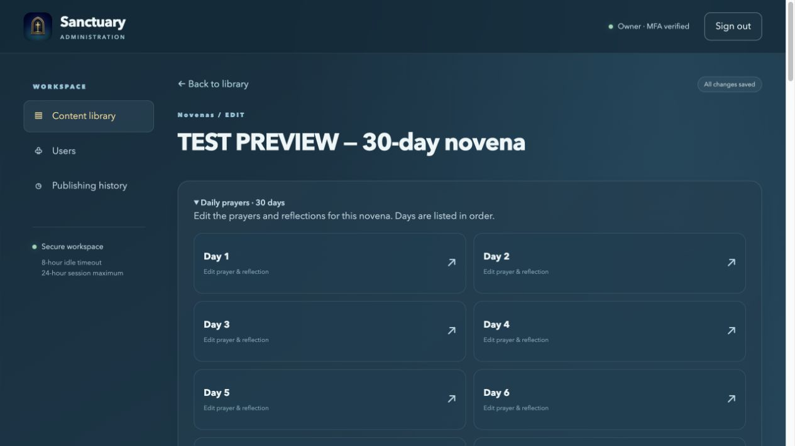

# Novena day editing

Branch `codex/admin-novena-days` starts from main at `cb16437`.

The content collection menu no longer exposes individual novena days as an unrelated catalogue. Open an existing novena and expand **Daily prayers** to see only its days, ordered numerically. Every entry starts with its day number; a blank title displays **Day 1**, not **Untitled**. Named days retain their title after the number.

Opening a day preserves its parent context and provides a Back to [novena] button. Returning reloads the parent and day list. Real unpublished edits still require a discard decision; cancelling keeps the day editor and its text. Editor focus and scroll move to the heading when opening content.

The authenticated `/admin-api/novenas/{id}/days` endpoint uses an exact parent ID and returns all its days, including those beyond the old 20-row catalogue page limit. Missing parents return 404. Existing day/detail/save endpoints retain their authentication and optimistic concurrency checks.

Existing longer novenas can now be edited: day validation uses the parent's actual duration, and edits to parent descriptions no longer require a nine-day duration. Existing duration, parent association, and day numbering remain immutable. New-novena creation retains the existing nine-day bundle workflow; this fix does not expand creation to arbitrary durations.

Deploy API before web because the editor uses the new day-list endpoint. No migration, native code change, or production content change is required.

Validation: 27 web tests passed; 74 API tests ran with zero failures/errors and one pre-existing skip. The integration regression covers an existing 30-day novena, numeric ordering, scoped lookup, Day 30 publication, and preserving duration. Web regression covers parent navigation, blank-title fallback, and keeping unsaved edits after cancellation. Six workflow-isolation checks passed with 82 assertions. Production web build passed with existing bundle/stylesheet/CommonJS warnings.

Local browser verification used explicitly labeled synthetic test content, not production records. The preview below demonstrates the layout only.

